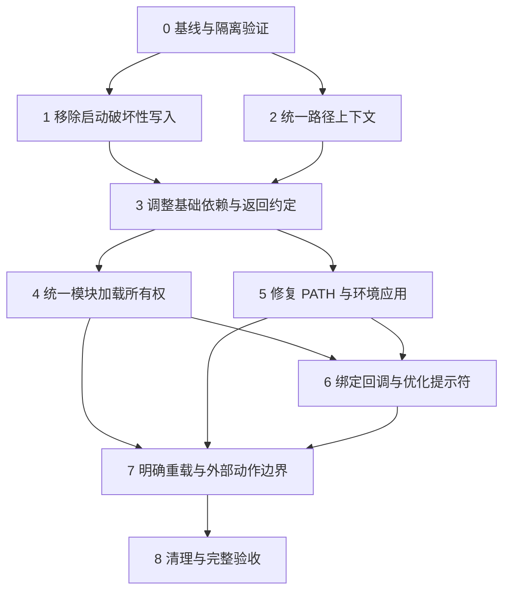

# main.module 分步骤修复方案

日期：2026-10-31。依据：`docs/startup-audit.md` 的 M01–M12。范围为 main 及其实际加载/调用的代码；不修改安装器内部流程，不扩展到 main 返回后由机器登录配置独立执行的流程。本次只制定方案。

## 1. 修复之间的依赖

不能把问题清单按编号逐项替换。路径决定加载对象，成功/失败约定决定何时发布状态，状态又决定是否允许跳过重复加载；环境应用与回调的生命周期决定重载是否正确。

第 1、2 步技术上可分别推进；第 4、5 步在第 3 步稳定后也可分别推进。实现时建议仍按编号提交，以缩小排查范围。箭头表示建议的实施前置条件，不表示每条修复都必须使用同一个新框架。

三个必须一起考虑的组合：

- **路径与 guard（M08/M09）**：只改 dirPathHome，旧 readonly rDirPath* 仍可能指向原地址；路径生成与公共配置 guard 必须协调。
- **依赖与返回码（M02/M04/M12）**：先让基础函数可用、明确各阶段结果，再依据结果截断依赖链。
- **去重与刷新（M03/M07/M09）**：函数定义可以避免重复解析，用户选项和环境仍需刷新；不能用一个永久 true guard 跳过整个 main。

## 2. 实施步骤及验收

### 第 0 步：保存可重复执行的基线

依赖：无。对应：全部问题的验证基础。

将已有临时 main 用例整理为仓库内独立的隔离验证入口，不使用带实际打包任务的 `module/test.module`。记录源码版本、加载次数、关键执行顺序、main 返回码、PATH 前后值、文件变化及外部命令调用次数。日志不打印用户配置全文或凭据。

分别测量 source main、首次提示符和稳定提示符；固定相同工作目录、PATH、Shell 版本和启用功能，区分首次加载与重复加载。现有注释里的毫秒值不能当基线。

**验收：**当前已确认问题能够稳定复现；所有写入限制在临时 HOME，launchctl/sudo/网络/设备操作均由 stub 替代。后续逐步将对应的“缺陷复现”断言改为“期望行为”断言。

### 第 1 步：独立修复 inputrc 删除风险

依赖：第 0 步。对应：M01，部分 M11。

改动集中在 `main.module:165`：常规启动不删除或替换已有 inputrc；正确链接保持不动，其他情况至多给出诊断。先保留现有用户文件和缺失状态。显式链接/迁移命令是否需要新增，可在后续功能动作步骤处理，不以改造安装器为前置条件。

**验收：**普通文件、目录、正确链接、其他链接、断链、路径缺失六种状态均无数据删除；启动无递归删除，无等待输入；已有正确配置继续有效。

### 第 2 步：统一路径上下文，消除双轨变量

依赖：第 0 步。对应：M08，部分 M09。

改动集中在 main 路径初始化和 `common.config`。建议仓库根目录从当前脚本真实位置解析，处理 `.bashrc` 符号链接；默认用户 HOME 使用当前 Shell 的 HOME，不能仅凭 USER 或 SUDO_USER 拼接 `/Users`。不同用户配置归属如需支持，作为明确输入，不自动混用另一用户配置与当前 HOME。

保持现有对外变量名，先集中生成和验证路径，再发布 rDirPath*/rFilePath*。路径上下文在一个 Shell 中固定；要切换仓库或身份时明确要求新 Shell，避免试图改写既有 readonly 常量。重载仍刷新选项和环境。进程内 guard 不 export；子 Shell 重新校验路径，不直接信任父进程的已初始化标志。

启动早期所需错误输出使用最小自包含实现，不依赖尚未加载的 common.methods。不引入依赖项目自身函数的路径解析循环；不假定系统 readlink 一定支持 GNU 参数。

**验收：**通过 `.bashrc` 链接、直接 source、带空格的仓库路径、HOME 与 USER 不一致、子 Bash、同进程重复加载均指向预期位置；不读写其他用户 HOME；路径解析失败明确返回非零。实现前确认现有 sudo 使用场景需要的身份策略，避免悄然改变其配置归属。

### 第 3 步：修正依赖顺序，建立可靠的返回约定

依赖：第 1、2 步。对应：M02/M04/M11/M12。

先检查 common.methods 的顶层语句，确保加载基础定义不要求用户选项已经存在。优先保持现有文件结构，将顺序调整为“路径配置 → 公共函数定义 → 用户配置”。只有确有循环依赖时才抽出最小基础函数，避免为顺序调整先拆大量文件。

按渐进方式处理用户配置：先保证旧配置在基础函数可用后执行；再把已确认的环境应用和系统动作迁出其顶层，保留原选项名。迁移不能先要求所有个人配置立即成为纯数据。

对受控配置、模块和阶段函数明确约定：成功返回 0，必需阶段失败返回非零并给出原因；可选功能缺失记录能力不可用。不能只给所有文件末尾补 `return 0`，那会继续掩盖前面的错误；也不能用配置最后一条普通条件判断的结果代表整体失败。

先对路径、公共定义及配置应用建立明确结果，再在 main 中检查并截断相关依赖。失败使用 return，保留可用的基础 Shell，不调用 exit 关闭用户终端。没有完整回滚能力时如实标记失败，不把部分初始化伪装成事务回滚。

main 中缺配置不再同步运行交互创建任务；给出明确诊断并停止 xbash 的依赖阶段。缺少用户扩展可按可选模块跳过，避免启动临时创建源码文件。必需/可选分类采用显式规则，不依赖“文件存在就算成功”。

**验收：**冷启动中的 ftEcho 可用；必需模块缺失、语法错误、显式执行失败均使 main 返回非零且不运行其依赖动作；可选模块缺失时基础 Shell 保持可用。测试覆盖“成功配置最后一个条件为假”，避免误报。最终 export 不覆盖已经记录的失败。

### 第 4 步：统一模块加载所有权和进程内状态

依赖：第 3 步。对应：M03/M09/M12，部分 M07。

以 main 为入口调度加载顺序，去掉已确认用户模块对 common/auto/git 的重复 source。模块若需要独立加载，应调用同一加载入口，而不是复制一套依赖逻辑。无需先建设通用插件系统或复杂依赖求解器；现有数量的模块可用显式顺序和轻量函数处理。

每个定义模块只记录当前 Shell 内的未加载、加载中、已加载、失败状态：检测加载中可发现循环；只有受控加载和必要能力验证成功后才设为已加载；失败可在明确重试时恢复。状态不 export，不使用它跳过环境刷新。补全同样检查当前 Shell 的实际注册/函数，不信任继承标志。

当前 `module/user` 被 Git 忽略：迁移前做备份，报告本地修改，不将个人文件强制加入 Git；仓库代码和模板承担长期规则。若不迁移真实用户模块，不能宣称重复加载已完全修复。

**验收：**一次 main 中各定义模块加载一次；普通重载不重复解析定义；子 Shell 自行完成加载；加载中递归依赖能诊断，失败模块不会永久伪装成已加载。用户扩展仍可在框架之后覆盖允许定制的函数。

### 第 5 步：统一 PATH 操作与当前 Shell 环境应用

依赖：第 3 步；与第 4 步无硬性先后要求。对应：M05/M07，部分 M08/M11。

提供集中使用的 PATH 添加、移除和去重方法。以冒号为分隔符，保留带空格、通配符字符和空项的原意；仅管理功能明确拥有的目录，保留其他项的相对顺序，不用 sdk/java/go 子串清扫整个 PATH。

迁移当前用户配置、相应模板及 main 中 pnpm/pipx 添加逻辑；固定个人目录改为路径上下文或明确选项。用户配置先读完，再由功能环境应用函数调用这些方法；赋值在当前 Shell 执行，不后台化。sudo、系统工具切换等动作进入显式功能命令。

**验收：**空 PATH、空项、带空格、字面通配符、重复项和相似目录名均符合约定；三次重载 PATH 不增长；开关关闭/重新启用不会移除无关路径；PATH 循环不再每项启动 sed/grep。现有变量引用继续兼容。

### 第 6 步：按能力绑定回调，缩短提示符同步工作

依赖：第 4、5 步。对应：M06/M09/M12。

在 Git 模块成功加载后注册 xbash 提示符回调；失败时保留基础提示符，不留下调用未定义函数的 PROMPT_COMMAND。保留用户既有回调和 history 行为，重复注册不产生重复项；覆盖已有字符串或数组形式前先核对实际 Shell 支持与现有值。

将枚举本地分支改为只读取当前分支，覆盖非 Git 目录、正常分支、未提交的新仓库和 detached HEAD；删除无消费者的版本比较。补全成功后才发布可用状态，子 Bash 重新检测能力。

先验证缩短同步查询的收益。只替换查询命令不能保证最坏等待时间有界；若要求慢文件系统下也及时返回，再单独实施带超时或后台缓存的方案。后台方案必须处理工作目录、Git 状态变化、结果代次、过期结果和子进程回收，不能把它塞进同一次简单替换提交。

**验收：**Git 不可用时无未定义函数错误；首次及重复提示符工作正确；回调不重复，原 history 行为保留。延迟 stub 用于区分“查询更少”和“等待有界”，未实现后者时不宣称阻塞彻底消失。

### 第 7 步：明确重载语义，分离外部动作

依赖：第 4、5、6 步。对应：M07/M10/M11/M12。

普通重载执行“重读选项 → 幂等应用当前 Shell 环境 → 更新回调”，复用成功加载的定义；开发时如需重载源码，提供单独的强制定义重载语义，而不是复用普通刷新。检查 `ftResetXbash` 与该入口的衔接，确保临时刷新参数不会被配置重新赋值覆盖，执行完成或失败均清理本次请求状态并保留实际结果。

main 不再因函数存在就执行会话级 launchctl 写入。建议改为明确的环境同步命令，用户需要自动同步时显式启用，并比较目标值、校验平台、报告失败。该行为变化应在实际实施前确认用户期望；本方案不据此擅自关闭已有功能。

版本诊断与功能应用分开，不把诊断建议当成环境已就绪的依据。inputrc 如需迁移，由单独动作保存原文件后处理；普通刷新继续不写它。重载失败返回非零，并允许修正配置后重试。

**验收：**连续三次普通刷新无重复定义加载、PATH 增长、回调增长或隐式外部写入；修改选项能够实际生效；错误后可重试；强制定义重载行为独立可测。保持工作目录，避免将当前 Shell 环境应用放入后台。

### 第 8 步：清理失效路径，完整验证并给出性能比较

依赖：第 7 步。对应：所有问题的收口。

删除已替代的重复逻辑、无消费者计算和误导性的固定耗时注释。历史功能开关只承诺实际触发的行为；不顺手重启已停用的后台历史整理等功能。同步模板与使用说明。

**验收矩阵：**冷启动、热启动、普通重载、强制重载、子 Bash、非交互 source；缺配置、缺模块、缺外部命令、模块执行失败及修正后重试；只读 HOME、带空格路径；非 Git/正常分支/detached HEAD；inputrc 六种状态；会话同步启用与禁用。

性能比较使用第 0 步相同场景，分别报告 source、首次提示符、后续提示符的多次测量中位数与尾部耗时，以及加载次数和外部进程次数。绝对性能目标应在真实基线出来后确定，不从现有注释推导。修复后的真实交互终端再做一次操作验证，补足无 PTY 隔离测试的限制。

## 3. 分批提交与回退

建议一个步骤形成一个可验证提交，复杂步骤按独立行为再细分：返回约定与严格检查保持在同一批，加载 guard 与用户重复 source 迁移保持在同一批，回调注册与 Git 能力判断保持在同一批。每批只运行相关回归用例，最后执行完整矩阵。

第 1 步的数据保留修复独立保留；后续重构需要回退时，不应重新引入删除行为。每批提交前保留相应的已知可用版本；本地忽略文件的备份单独管理，不能认为 git revert 会恢复它们。涉及运行时协议的提交按依赖逆序回退，避免新调用方配旧模块。

最终目标是：先让启动结果可信、文件操作可控，再减少重复工作，最后优化提示符响应和重载体验。每一步都有可见的行为变化及验收条件，不需要一次性重写 main。
